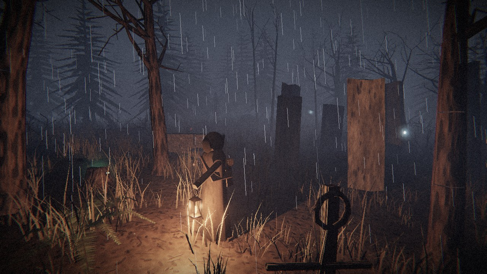

# Lanternlight

A night walk across an endless moor with one lantern, in the rain. The dark out here is not empty.

**[Play it in your browser](https://macterra.org/lanternlight/)**



## What it is

A casual open-world exploration game. There is no map, no health bar and no way to lose. You walk, and the world goes on for as far as you care to go.

- **Lights.** Pale lights drift over the moor. Each one you gather makes your lantern reach a little further.
- **Beacons.** Stone cairns with a fire bowl. Walk up to one to light it, and it keeps burning after you leave.
- **Landmarks.** Nine strange places are scattered around. Finding one adds it to your journal.
- **Company.** Something tall sometimes stands at the edge of your light, or behind you. If you look straight at it, it goes. If you ignore it, it comes closer each time the flame gutters. It will not stand in a beacon's light.

Progress is saved in your browser.

## Controls

| | |
|---|---|
| Walk | `W` `A` `S` `D` or arrow keys |
| Hurry | `Shift` |
| Look around | drag with the mouse, or `Q` / `E` |
| Zoom | scroll |
| Journal | `J` |
| Sound on/off | `M` |

On a touch screen, drag to walk and use a second finger to look around.

Sound matters in this one. Headphones help.

## Running it yourself

The whole game is one file, [index.html](index.html). It has no build step, and loads [three.js](https://threejs.org/) from a CDN, so it needs an internet connection the first time.

Serve the folder with any static file server and open the page. On Windows, with nothing else installed:

```
powershell -ExecutionPolicy Bypass -File serve.ps1
```

then open <http://localhost:8377/>.

## How it works

- The moor is generated from a fixed seed in 16 m chunks as you walk, so it is the same place every visit.
- Trees, rocks, textures and sounds are all made in code. There are no image or audio files.
- Each chunk's scenery is merged into a few meshes to keep the frame rate up.
- The lantern is a single shadow-casting point light. Rain, mist, film grain and colour grading are layered on top.
